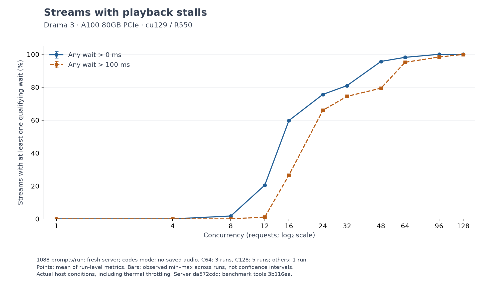
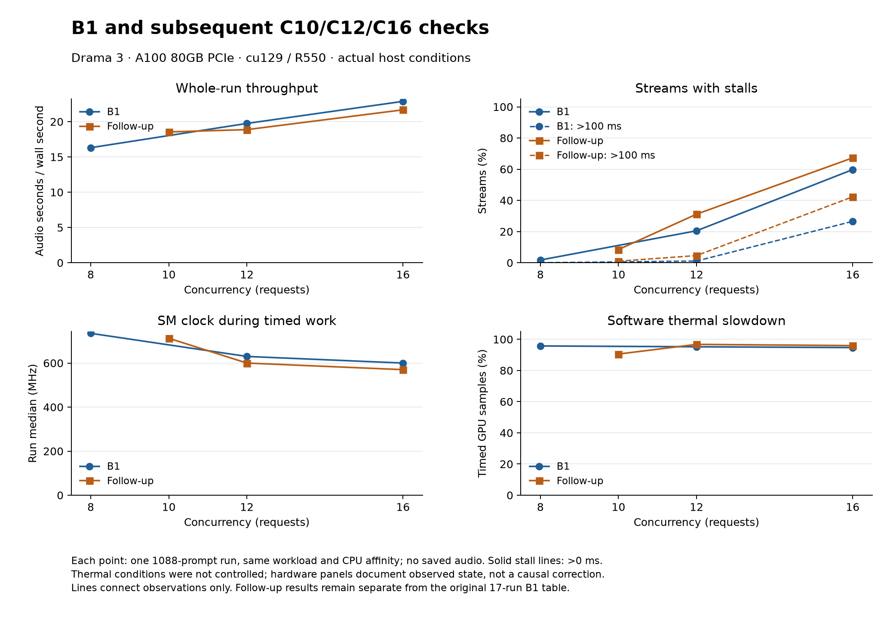
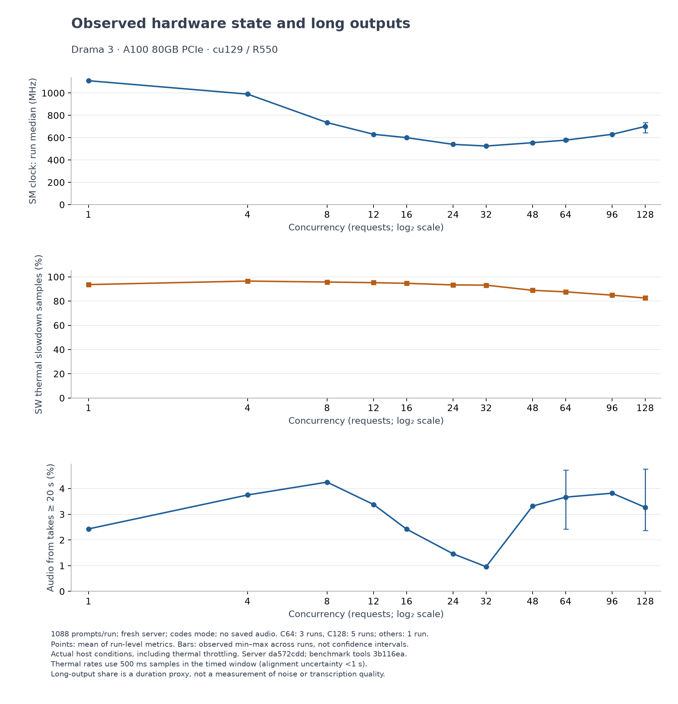

# Drama 3 / A100：C128 容量检查、B1 与拐点补测

**C128 容量检查通过；17 次 B1 共 18,496 条请求全部成功，另 3 次补测共 3,264 条全部成功。保留的服务器日志未检出 OOM 或抢占。** 本报告记录 2026-10-20 的实际机器条件，未修改服务器模型源码。

本轮不能视为受控频率下的 A100 上限：全部 17 次 B1 都出现软件热降频，计时区间采样占比约 **81.58%–96.51%**，各运行 SM 频率中位数 **525–1110 MHz**。后续优化必须同时检查热状态，不能把不同频率下的差值直接归因于代码。

后续 [C8/C16/C64 decode 与混合步 profile](../20261020_214308_profiles/README.md) 已完成，包含原始 kernel 归因、CPU路径分析及下一项实验建议；profile 数字没有混入本基线。

## 固定条件与计数

- vLLM-Omni `da572cddb38383deae9caef33b8d490e292ef071`；压测工具 `3b116ea1a7f39323e517804900aa7bb016bafdf1`。
- `fishaudio/drama-3` revision `b2b5ee998034b2975720906c815e7fb0e9f007bd`，Seed-TTS-Eval 英文 1088 条预编码 references，codes 模式。
- NVIDIA A100 80GB PCIe，物理 GPU 1；vLLM 0.32.0+cu129、PyTorch 2.13.0+cu129、驱动 550.127.05。**不是官方 cu130 / R580+ 环境。** 未升级系统驱动或 CUDA，未更改功耗上限、频率或风扇。
- 默认 BF16 GDN 状态配置。每次全新服务、8 条预热不计时、默认采样且不显式传 seed，不打乱样本顺序，不保存音频。
- 服务 CPU `0–27,32–59`；客户端 `60–63`；服务也排除其 SMT 同胞 `28–31`。这是进程亲和性限制，不是机器级独占 CPU 预留。
- 主 B1 共 17 次：C1/4/8/12/16/24/32/48/64/96/128，C64 总计3次、C128总计5次。后续 C10/C12/C16 各一次独立存放，没有覆盖主测。
- 所有输出在个人 NVMe；[源与模型哈希](source-lock.json)、[计划](b1-plan.json)、[部署配置](deploy_config.yaml)、[参数核验](postprocessing/followup-comparison/comparison.json)。

## C128 容量短测

256/256 成功，无 OOM 或抢占日志。客户端峰值在途数重算为128，满128约7.62秒；计时14.545秒，loop-lag p99为0.96 ms。达到500帧上限的2条贡献4.18%的音频时长。

该短测 GPU 温度60–67°C、没有软件热降频，仅用于本负载容量门禁，不能替代较热状态的全量性能基线。见 [独立审计](c128-independent-audit.json)、[并发窗口重算](c128-independent-concurrency.json)、[硬件记录](c128-hardware-summary.json)。

## 主 B1 结果

| 并发 | 次数 | 全程吞吐 audio-s/s | 平均 RTF | TTFA p95 ms | 有 >100 ms 等待的流 |
| ---: | ---: | ---: | ---: | ---: | ---: |
| 1 | 1 | 4.10 | 0.246 | 162 | 0.00% |
| 4 | 1 | 11.49 | 0.351 | 247 | 0.00% |
| 8 | 1 | 16.31 | 0.493 | 322 | 0.00% |
| 12 | 1 | 19.75 | 0.607 | 365 | 1.10% |
| 16 | 1 | 22.88 | 0.699 | 412 | 26.56% |
| 24 | 1 | 27.41 | 0.866 | 494 | 65.99% |
| 32 | 1 | 30.58 | 1.030 | 587 | 74.45% |
| 48 | 1 | 39.49 | 1.180 | 776 | 79.41% |
| 64 | 3 | 46.06（45.39–46.81） | 1.348 | 957 | 95.16% |
| 96 | 1 | 56.30 | 1.636 | 1314 | 98.35% |
| 128 | 5 | 62.94（62.38–64.04） | 1.891 | 1693 | 99.93% |

重复档位先计算每次指标，再取运行级均值；括号为观察到的 min–max，**不是置信区间**。TTFA p95 的均值也不是合并全部请求后的 p95。RTF 为逐请求墙钟时长除以音频时长的平均，不是全批次时间除以总音频。完整的双卡顿阈值、满并发窗口吞吐与长音频计数见 [原始汇总表](b1/table.md) 和 [数值数据](postprocessing/figures/plot_data.json)。

另见 [吞吐](postprocessing/figures/throughput.png)、[RTF](postprocessing/figures/rtf.png)、[TTFA](postprocessing/figures/ttfa.png)；同目录提供 SVG。

17次、18,496条全部成功；每次 loop-lag p99 均小于1 ms，最大0.96 ms，记录到的单次 loop-lag 最大6.4 ms。见 [独立完整性审计](b1-independent-audit.json) 和 [逐项发现](postprocessing/BASELINE_FINDINGS.json)。

## C10 补点与 C12/C16 复测

| 并发 | >0 ms：主测 → 补测 | >100 ms：主测 → 补测 | RTF：主测 → 补测 |
| ---: | ---: | ---: | ---: |
| 10 | — → 8.46% | — → 1.01% | — → 0.540 |
| 12 | 20.50% → 31.16% | 1.10% → 4.60% | 0.607 → 0.632 |
| 16 | 59.74% → 67.28% | 26.56% → 42.28% | 0.699 → 0.738 |

C4 的两种阈值均为0%；C8 为1.75% / 0%。本机本轮的短暂等待随 C8→C10→C12 增多，超过100 ms的等待在 C12→C16 显著增加；不存在由这些单次点确定的普适“精确拐点”。C12/C16 重复差异还受到生成长度和热状态变化影响，不能只用独立抽样误差解释。

补测三次、3,264条全部成功，软件/部署/输入/CPU亲和性等参数核验一致，热状态未被控制。详见 [补测审计](followup-independent-audit.json)、[对照表与解释](postprocessing/followup-comparison/comparison.md)、[逐运行数值](postprocessing/followup-comparison/comparison.json)。

## 热状态、长输出与解释范围

软件热降频由原始 active mask、显式 nvidia-smi 查询和本地 NVML 常量共同验证。计时区间最高温度86°C。硬件统计按每次 `started_at + duration_s` 截取，开始时间只有秒级精度；报告提供去除首秒的边界敏感性检查。比例是采样占比，不是精确时间占比。见 [硬件汇总](b1-hardware-summary.json)、[降频原因证据](independent-audit-tools/thermal_reason_evidence.json)。

本轮 `>=20s` 和达到500帧的计数只由输出时长/字节数计算。**没有保存音频，不能称为 noise-run、WER 或人工听感判断。** 吞吐包括这些长输出产生的音频秒数，比较时必须同时看其音频占比。

之前保存音频的质量 C16 使用 seed 0、不同 CPU 亲和性且 SM 中位数约1005 MHz；主 B1 C16 不显式传 seed、SM 中位数600 MHz。因此 27.98→22.88 audio-s/s 的差异不能归因于是否保存音频，见 [历史质量运行对照](c16-quality-comparison.json)。

## 复现与公开副本

外置 supervisor 把停止信号交给本轮 API，记录自身 API/stage/MPS 的 PID 与创建时间，并检查端口和显存释放；它还拒绝在前一轮结果不完整或存在外来 GPU 进程时继续。原始 `run_sweep.sh` 与客户端计时逻辑未修改。最终 [GPU 交接记录](gpu-handoff.json) 显示无本轮计算/监控进程、GPU 1 为15 MiB / 0%、8091空闲；这是进入后续 profile 之前的检查。

公开副本保留逐请求数据、GPU采样、每轮元数据和清理记录；服务器日志脱敏后压缩为 `server.log.gz`。个人路径、主机名和 GPU UUID 替换为占位符，指标保持不变。原始未脱敏日志与后续完整 trace 留在个人 NVMe。见 [发布清单](publication.json)，根目录 `SHA256SUMS` 校验公开文件。
