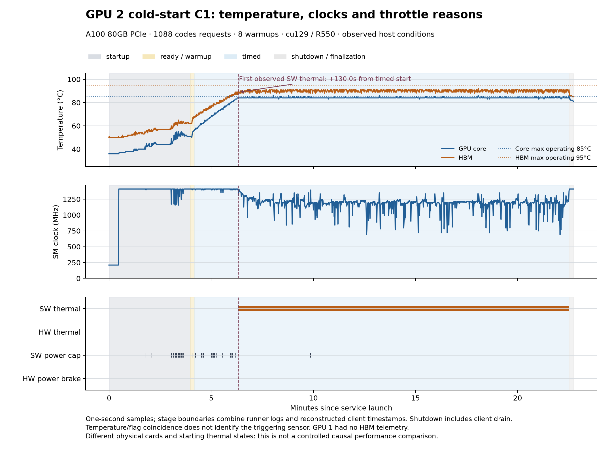

# GPU 2 冷态 C1：仍出现持续热降频

2026-10-21，在空闲的物理 GPU 2（A100 80GB PCIe）从核心36°C、HBM50°C开始启动服务。**正式C1请求开始约130秒后出现软件热降频；最后5分钟全部采样仍处于该状态。冷态启动没有避免这次持续负载下的热降频。**

## 运行条件

与此前B1相同：server `da572cdd`，执行工具源码 `3b116ea`，默认BF16部署，codes模式、1088条、8条预热、不保存音频、不显式传seed；服务CPU `0–27,32–59`、客户端`60–63`，同一私有cu129环境。只把物理GPU换为2，并验证两个stage与私有MPS映射正确。没有修改时钟、功耗、风扇、驱动或系统CUDA。

本次运行时结果仓库HEAD为`32afcea`，工具字节仍为`3b116ea`；用户新提交的`9f66301` thermal gate是在本次完成后才同步，**本次未使用分段测量或冷却暂停**。实际执行脚本另保存在 [executed-tools](executed-tools/stream_bench.py)。

## 核心结果

| 项目 | 结果 |
| --- | ---: |
| 服务启动前核心 / HBM | 36 / 50°C |
| 正式计时开始附近核心 / HBM | 约56 / 67–68°C |
| 首次热降频采样 | 00:36:02.421，正式请求后129.951秒 |
| 首次标志时核心 / HBM / SM | 84°C / 89°C / 1305 MHz |
| 计时期间热降频采样占比 | 88.22% |
| 最后5分钟热降频采样占比 | 100% |
| 计时期间核心 / HBM最高 | 86 / 92°C |
| 计时期间SM最低 / 中位数 / 最高 | 690 / 1200 / 1410 MHz |
| 请求成功 / 失败 | 1088 / 0 |
| 正式计时 | 1100.819秒，不含启动与预热 |
| 吞吐 / 平均RTF | 4.34 audio-s/s / 0.2322 |
| >0 ms / >100 ms卡顿流 | 0 / 0 |
| 客户端loop-lag p99 | 0.64 ms |

前一个未激活样本为00:36:01.420，所以触发时间只定位在相邻约1秒的采样间隔内。690 MHz也是采样到的最低值，不保证捕获所有更短瞬时变化。之后约969秒持续观测到热降频；原始序列和分段统计全部保留。

此前 GPU 1 C1 用时1165.357秒；本次少64.538秒，耗时下降约5.54%。两次物理GPU、起始温度和热历史不同，**不能把性能差异单独归因于冷启动或某个软件变化**。GPU1旧实验没有HBM温度记录。

## 风扇检查

`nvidia-smi` 显示GPU风扇为N/A。A100 80GB PCIe标准卡使用被动散热器，需要系统气流；N/A不能说明机箱风扇停止。[NVIDIA产品说明](https://www.nvidia.com/content/dam/en-zz/Solutions/Data-Center/a100/pdf/PB-10577-001_v02.pdf)

主板识别为Supermicro H12SSL-i。当前账号无法访问root权限的`/dev/ipmi0`，IPMI只读查询失败，非交互sudo要求密码。因此没有获得机箱风扇RPM/控制模式，也未进行调整。需要管理员读取风扇状态、检查风道和控制策略，不能仅从温度认定“风扇没开”。见 [只读检查记录](fan_readonly_check.json)。

本卡查询的GPU Max Operating为85°C、GPU Slowdown为89°C、HBM Max Operating为95°C。首个热降频样本的HBM89°C低于95°C；这些采样不能确定具体触发传感器，更不能把89°C当成显存阈值。

## 证据与清理

- [独立报告](independent-analysis/COLD_GPU2_FINDINGS.md) / [详细统计](independent-analysis/COLD_GPU2_FINDINGS.json) / [时间线CSV](independent-analysis/timeline.csv) / [SVG](independent-analysis/timeline.svg)。
- [原始连续遥测](thermal_continuous.csv)、[客户端summary](sweep/c1/r1/summary.json)、[逐请求记录](sweep/c1/r1/requests.jsonl)、[关键日志](sweep/c1/r1/key_lines.txt)、[完整服务器日志（gzip）](sweep/c1/r1/server.log.gz)。
- [实验配置](experiment.json)、[版本与源哈希](source-lock.json)、[启动前查询](nvidia-smi-before.txt)、[运行审计](sweep/validation.json)。
- [最终清理](final_cleanup.json)：GPU2为14 MiB / 0%，无本轮API/stage/MPS/采样进程，8091空闲。仅结束本轮自有进程。

公开副本替换个人路径、主机名和GPU UUID，指标不变。原始证据保留在个人NVMe，见 [发布清单](publication.json)，全分支校验值在根目录SHA256SUMS。
